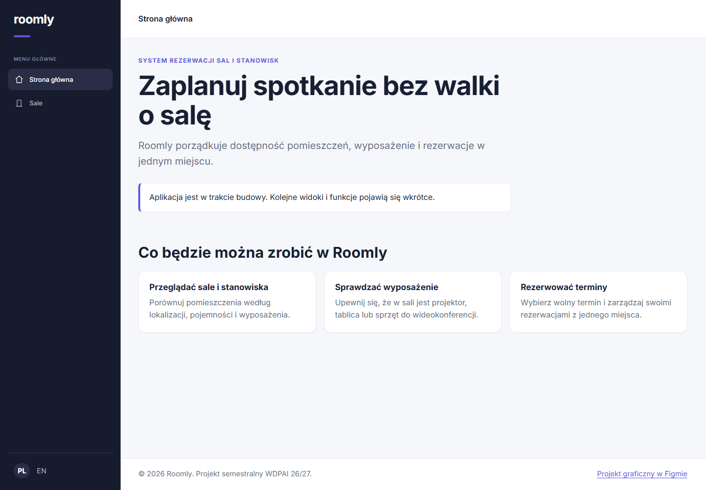
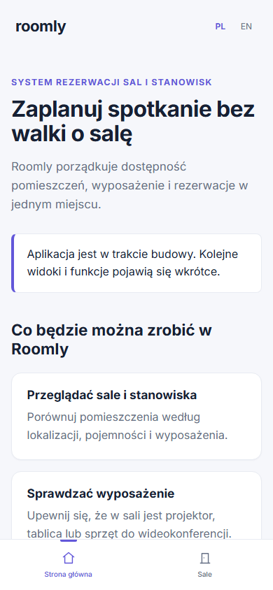
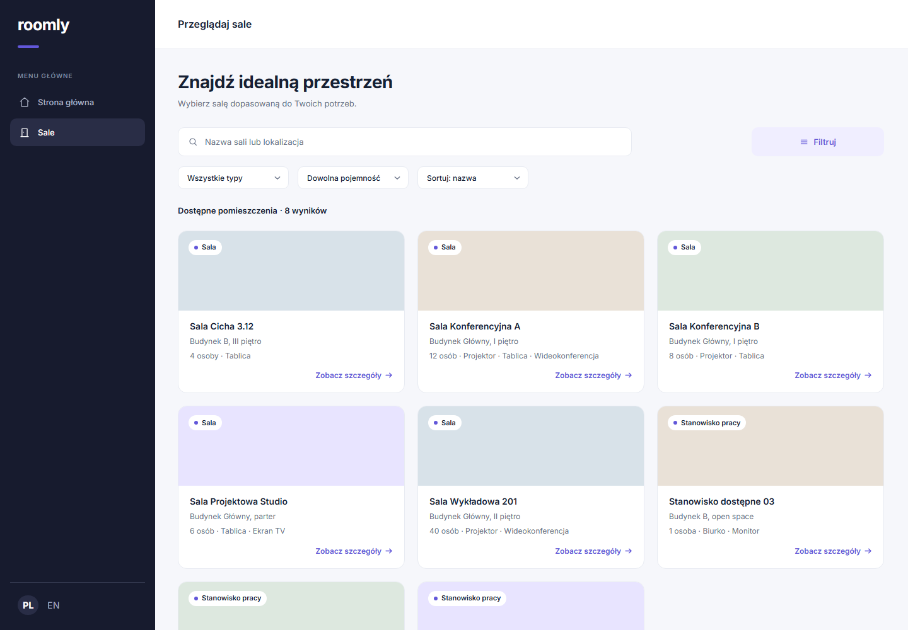
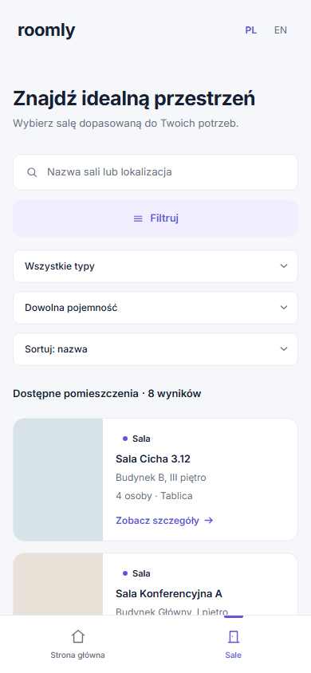
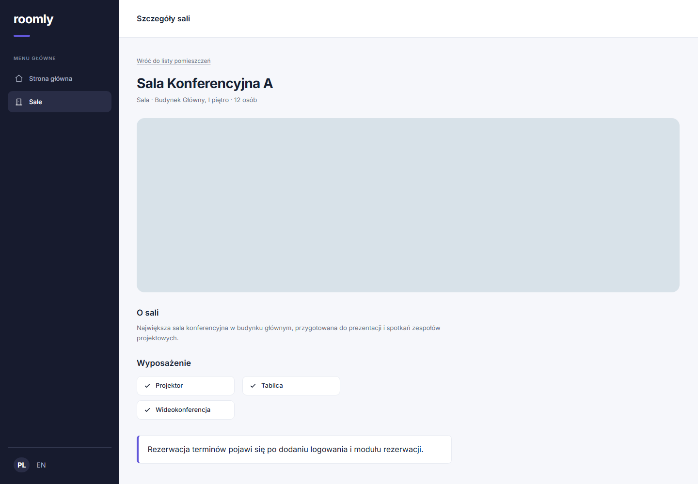
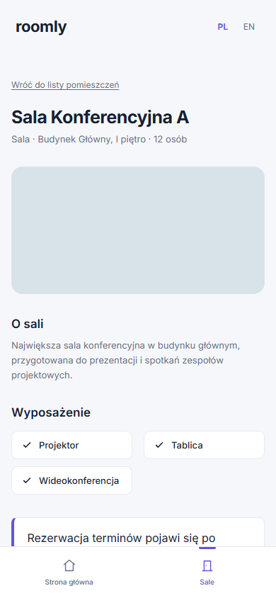
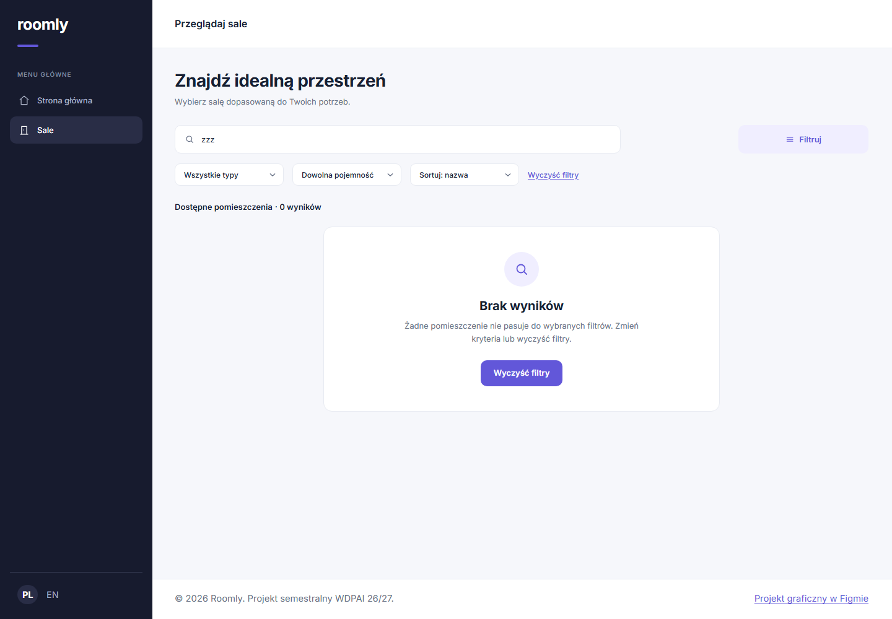
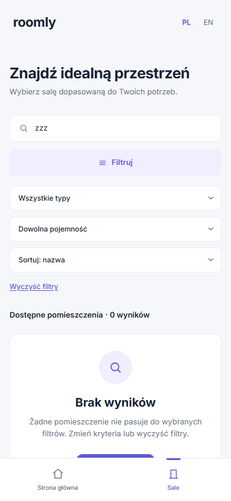
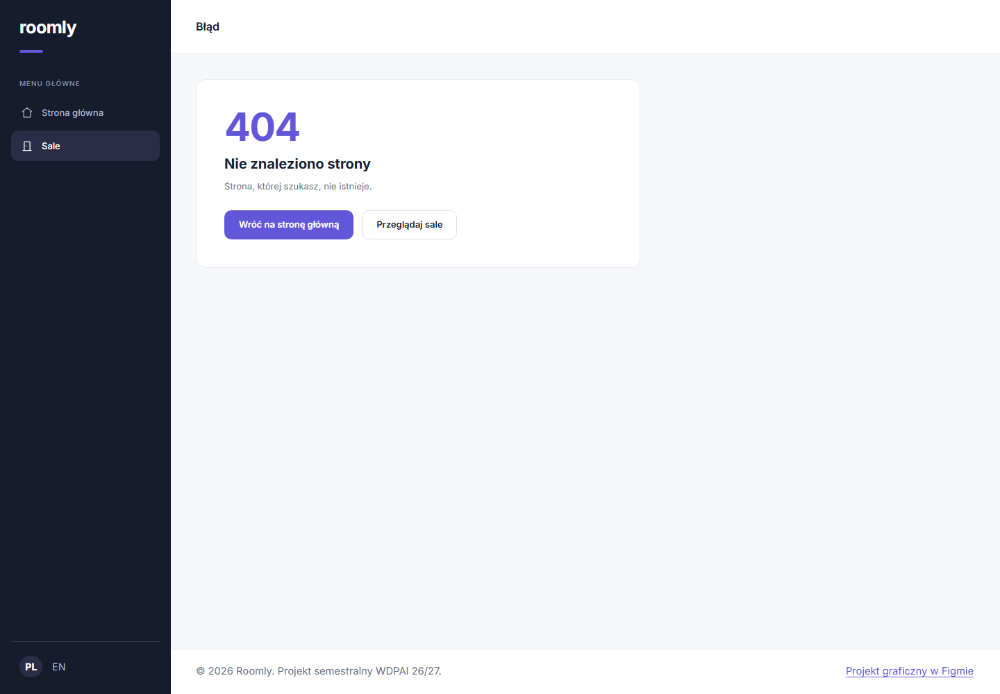
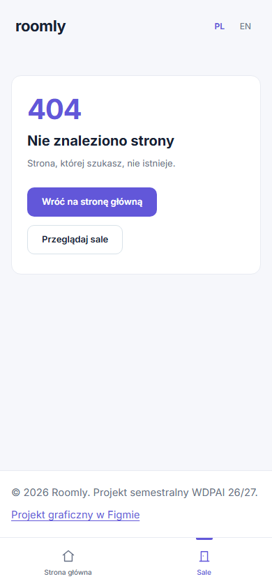

# Roomly — System Rezerwacji Sal i Stanowisk

Roomly to aplikacja webowa do przeglądania i rezerwowania sal oraz stanowisk pracy. Użytkownik wyszukuje pomieszczenia, filtruje je według typu i pojemności, sprawdza wyposażenie, a w docelowej wersji rezerwuje termin i zarządza swoimi rezerwacjami. Administrator zarządza użytkownikami, lokalizacjami, pomieszczeniami, wyposażeniem i rezerwacjami.

Projekt semestralny z przedmiotu **Projektowanie aplikacji internetowych 26/27**. Backend powstaje w PHP 8.3 w architekturze MVC, bez frameworka PHP; środowisko uruchamiane jest przez Docker Compose.

## Autorzy i zakres odpowiedzialności

- **Kacper Wesołowski** — projekt i implementacja aplikacji.

## Opis problemu i główne funkcje

W typowej firmie lub na uczelni rezerwacja sali odbywa się przez kilka kanałów: arkusze, e-maile i ustne ustalenia. Trudno sprawdzić, czy sala jest wolna, jakie ma wyposażenie i kto odpowiada za dany termin. Roomly ma połączyć katalog pomieszczeń, filtrowanie, dostępność i rezerwacje w jednym miejscu.

### Co działa w obecnej wersji (Laboratorium 3)

- Front controller, router (`GET`, `POST`, `PATCH`, `DELETE`), parametry ścieżki z walidacją, własne wzorce regex, kontrolowane `400` i `404`.
- Tłumaczenia PL/EN z zapamiętaniem języka w sesji; przełącznik zachowuje filtry.
- Powłoka aplikacji: stały sidebar i topbar na desktopie, dolna nawigacja na mobile.
- Strona główna z informacją o etapie prac.
- Katalog `/rooms`: wyszukiwanie po nazwie i lokalizacji, filtr typu, progi pojemności, sortowanie, licznik wyników z odmianą, stan „brak wyników” i czyszczenie filtrów.
- Szczegóły `/rooms/{id}`: podsumowanie, opis, wyposażenie w formie chipów, powrót do katalogu.
- Stany błędów `400`, `404`, `500` z linkami do strony głównej i katalogu.
- Osiem pomieszczeń demonstracyjnych w pamięci (`InMemoryRoomRepository`).
- Testy jednostkowe PHPUnit.

### Planowane w kolejnych laboratoriach

- Schemat PostgreSQL, dane demo SQL i repozytoria PDO (Lab 7).
- Rejestracja, logowanie, role `USER`/`ADMIN`, sesja (Lab 9).
- JavaScript, walidacja po stronie klienta i Fetch API (Lab 10–11).
- Rezerwacje z ochroną przed nakładaniem się terminów (Lab 7–12).
- Panel administratora, „Moje rezerwacje”, profil — po dodaniu bazy i logowania.
- Galeria sal, upload zdjęć, e-maile i CRON (Lab 13).
- Motyw ciemny/jasny oraz pełny audyt WCAG (Lab 5, 14).
- Wdrożenie publiczne (Lab 14).

## Stack technologiczny

| Warstwa | Technologia |
|---|---|
| Backend | PHP 8.3, MVC bez frameworka, Composer PSR-4, `strict_types` |
| Serwer HTTP | Nginx + PHP-FPM |
| Baza danych | PostgreSQL 16 (kontener gotowy; aplikacja jeszcze nie korzysta) |
| Frontend | HTML5, CSS3 z tokenami; JavaScript bez frameworka (Lab 10–11) |
| Testy | PHPUnit 11 |
| E-mail | PHPMailer + SMTP, lokalnie Mailpit (planowane, Lab 13) |
| Konteneryzacja | Docker, Docker Compose |

## Zrzuty ekranu

Zrzuty wykonano na działającej aplikacji: desktop 1440×1000, mobile 390×844.

| Widok | Desktop | Mobile |
|---|---|---|
| Strona główna |  |  |
| Katalog sal |  |  |
| Szczegóły sali |  |  |
| Brak wyników |  |  |
| Błąd 404 |  |  |

## Architektura

```text
przeglądarka
  → Nginx
  → public/index.php (front controller, sesja, konfiguracja, trasy)
  → App\Routing
  → kontroler (App\Controller)
  → serwis (App\Service) / repozytorium (App\Repository)
  → model (App\Model)
  → widok HTML (public/views) albo odpowiedź JSON
```

| Warstwa | Odpowiedzialność |
|---|---|
| `public/index.php` | bootstrap, autoload, sesja, złożenie zależności, rejestracja tras, dispatch, obsługa błędów |
| `App\Routing` | dopasowanie metody HTTP i wzorca ścieżki, walidacja parametrów |
| `App\Controller` | walidacja wejścia, wywołanie logiki, wybór widoku lub JSON, kody HTTP |
| `App\Service` | logika domenowa, np. `RoomFilter` — walidacja i filtrowanie zapytań |
| `App\Repository` | dostęp do danych; dziś `InMemoryRoomRepository`, docelowo PDO |
| `App\Model` | obiekty domenowe, np. `Room` |
| `App\Support` | `View`, `Translator`, `Html`, `HttpException` |
| `public/views` | layout, partiale i widoki oparte na `htmlspecialchars` |

Zależności są przekazywane przez konstruktory i składane w jednym miejscu — w `public/index.php`. Repozytorium jest ukryte za `RoomRepositoryInterface`, więc podmiana danych w pamięci na PDO nie wymaga zmian w kontrolerze.

```text
.
├── AGENTS.md
├── README.md
├── composer.json
├── docker-compose.yaml
├── phpunit.xml
├── .env.example
├── docker/
│   ├── db/
│   ├── nginx/
│   └── php/
├── docs/
│   └── screenshots/          # zrzuty z README
├── public/
│   ├── css/style.css         # tokeny, komponenty, layout, stany
│   ├── index.php             # jedyny punkt wejścia
│   └── views/
│       ├── layout.html.php
│       ├── partials/         # sidebar, nagłówek, nawigacja, stopka, i18n
│       ├── rooms/            # katalog i szczegóły
│       └── errors/
├── src/
│   ├── Controller/
│   ├── Model/
│   ├── Repository/
│   ├── Service/
│   ├── Support/
│   └── Routing.php
├── tests/
│   ├── bootstrap.php
│   └── Unit/
└── translations/
    ├── pl.php
    └── en.php
```

## Routing / endpointy

| Metoda | Ścieżka | Opis | Dostęp |
|---|---|---|---|
| GET | `/` | Strona główna | publiczny |
| GET | `/rooms` | Katalog sal i stanowisk z filtrami | publiczny |
| GET | `/rooms/{id}` | Szczegóły pomieszczenia; `{id}` musi być liczbą całkowitą | publiczny |

Parametry zapytania obsługiwane przez `/rooms`:

| Parametr | Wartości | Znaczenie |
|---|---|---|
| `q` | tekst do 80 znaków | Szuka w nazwie i lokalizacji, bez rozróżniania wielkości liter |
| `kind` | `room`, `workstation` | Rodzaj pomieszczenia |
| `min_capacity` | liczba 1–1000 | Minimalna liczba miejsc |
| `sort` | `name`, `capacity` | Kolejność wyników (domyślnie `name`) |
| `lang` | `pl`, `en` | Język interfejsu, zapamiętywany w sesji |

Przykład: `/rooms?q=budynek+b&kind=workstation&min_capacity=4&sort=capacity`.

Router obsługuje metody `GET`, `POST`, `PATCH` i `DELETE`, parametry ścieżki `{id}` z walidacją formatu oraz własne wzorce regex, np. `{slug:[a-z0-9-]+}`. Obecnie zarejestrowane są tylko trasy `GET`.

| Przypadek | Odpowiedź |
|---|---|
| `/rooms/abc` | `400 Bad Request` — parametr nie jest liczbą |
| `/rooms?kind=garage` | `400 Bad Request` — niedozwolona wartość filtra |
| `/rooms/999` | `404 Not Found` — poprawny format, brak zasobu |
| nieistniejąca trasa | `404 Not Found` |

## Uruchomienie przez Docker

Wymagania: Docker Desktop lub Docker Engine z Docker Compose v2 oraz wolne porty `8080`, `5433`, `8025`, `5050` (opcjonalnie `11434` dla Ollamy).

1. Utwórz `.env` na podstawie `.env.example`:

   ```powershell
   Copy-Item .env.example .env
   ```

   Linux/macOS:

   ```bash
   cp .env.example .env
   ```

2. Zainstaluj zależności PHP:

   ```bash
   docker compose run --rm --no-deps php composer install
   ```

3. Uruchom kontenery:

   ```bash
   docker compose up --build -d
   ```

4. Otwórz aplikację:

   - Aplikacja: [http://localhost:8080](http://localhost:8080)
   - Mailpit: [http://localhost:8025](http://localhost:8025)
   - pgAdmin: [http://localhost:5050](http://localhost:5050)

5. Zatrzymanie:

   ```bash
   docker compose down
   ```

Nie używaj `docker compose down -v` bez potrzeby — usuwa wolumen z danymi bazy.

Kontener PostgreSQL jest uruchamiany i gotowy na kolejne laboratoria, ale **aplikacja jeszcze się z nim nie łączy**.

### Ollama (opcjonalnie)

Domyślne `docker compose up` nie uruchamia Ollamy. Aby włączyć lokalne modele AI:

```bash
docker compose --profile ai up -d ollama
```

Ollama działa również bez GPU (wolniej) i nie jest warunkiem działania Roomly.

## Zmienne środowiskowe

Wszystkie wymagane zmienne znajdują się w `.env.example`. Plik `.env` jest lokalny i nie trafia do repozytorium.

| Zmienna | Znaczenie |
|---|---|
| `APP_PORT` | Port aplikacji na komputerze gospodarza |
| `POSTGRES_DB`, `POSTGRES_USER`, `POSTGRES_PASSWORD` | Konfiguracja kontenera PostgreSQL |
| `POSTGRES_PORT` | Port PostgreSQL na komputerze gospodarza |
| `DB_HOST`, `DB_PORT`, `DB_NAME`, `DB_USER`, `DB_PASSWORD` | Połączenie PHP z PostgreSQL; wykorzystane po dodaniu warstwy bazy (Lab 7) |
| `PGADMIN_DEFAULT_EMAIL`, `PGADMIN_DEFAULT_PASSWORD` | Konto pgAdmin |
| `PGADMIN_PORT`, `PGADMIN_CONTAINER_NAME` | Port i nazwa kontenera pgAdmin |
| `MAIL_HOST`, `MAIL_PORT`, `MAIL_FROM`, `MAIL_FROM_NAME` | Konfiguracja SMTP/Mailpit |

## Import bazy i dane demonstracyjne

Schemat bazy i import SQL **nie są jeszcze zaimplementowane**. Katalog korzysta z `App\Repository\InMemoryRoomRepository` — osiem pomieszczeń zapisanych w kodzie, udostępnianych przez `RoomRepositoryInterface`:

- 5 sal (m.in. Sala Konferencyjna A — 12 miejsc, Sala Wykładowa 201 — 40 miejsc),
- 3 stanowiska pracy (1 miejsce każde),
- lokalizacje, opisy i wyposażenie (projektor, tablica, wideokonferencja, ekran TV, biurko, monitor, stacja dokująca, telefon).

Dane służą do pokazania routingu, filtrowania i widoków. **Nie są warstwą bazy danych** i nie są trwałe. Schemat PostgreSQL, `database/01-schema.sql`, `database/02-seed.sql` i repozytorium PDO pojawią się w Laboratorium 7. Docelowy model encji opisuje [`AGENTS.md`](AGENTS.md) w sekcji 2.3.

## Diagram ERD bazy danych

Schemat bazy nie jest jeszcze zaimplementowany, więc README nie publikuje ERD, który sugerowałby istniejące tabele. Docelowy model (`users`, `user_settings`, `locations`, `rooms`, `equipment`, `room_equipment`, `room_photos`, `reservations`, `reservation_reminders`) jest opisany w [`AGENTS.md`](AGENTS.md) w sekcji 2.3. Diagram Mermaid zgodny ze `database/*.sql` zostanie dodany razem ze schematem w Laboratorium 7.

## Testy

Testy jednostkowe uruchamia się w kontenerze `php`:

```bash
docker compose exec php vendor/bin/phpunit
```

Jednorazowo, bez uruchamiania całego środowiska:

```bash
docker compose run --rm php vendor/bin/phpunit
```

Aktualny wynik: **38 testów / 60 asercji**.

Zakres:

- dopasowanie tras: trasa statyczna, parametry ścieżki, własny regex, `400`/`404`, metody HTTP;
- walidacja i filtrowanie katalogu: `RoomFilter` (query, typ, pojemność, sortowanie, błędne wartości);
- repozytorium w pamięci: pobieranie listy i pojedynczego pokoju;
- tłumaczenia: formy liczby mnogiej PL/EN (`1 wynik`, `3 wyniki`, `5 wyników`).

Testy nie wymagają bazy danych.

## Raport WCAG

**Data:** 2026-11-19 · **Zakres:** strona główna, katalog, szczegóły, brak wyników, 404 · **Szerokości:** 320, 390, 768, 1024, 1440 px.

Metoda: testy manualne (klawiatura, skip link, fokus, responsywność) oraz skryptowy audyt DOM i kontrastu w Chrome. To nie jest formalna certyfikacja WCAG — pełny audyt z narzędziami zewnętrznymi zaplanowano na Laboratorium 14.

| Kryterium | Wynik |
|---|---|
| Hierarchia nagłówków | `h1` → `h2` → `h3` na wszystkich widokach |
| Landmarki i etykiety | `header`, `nav`, `main`, `footer`; nawigacje i grupy mają `aria-label` |
| Formularze | Wszystkie pola mają etykiety (w filtrach ukryte wizualnie) |
| Klawiatura | Pełna obsługa; logiczna kolejność Tab; brak pułapek fokusa |
| Skip link | „Przejdź do treści” przenosi fokus do `main` |
| Widoczny fokus | Obrys 3 px `#6257d9`; na ciemnym sidebarze kontrast 3.2:1 |
| Kontrast tekstu | 0 błędów w audycie 5 widoków (4.5:1 dla tekstu, 3:1 dla dużego) |
| Reflow 320 px | Brak poziomego przewijania |
| Cele dotykowe | Min. 24 px; linki kart wykorzystują całą powierzchnię karty |
| `prefers-reduced-motion` | Animacje i przejścia wyłączone |
| Język | `<html lang>`, `lang` na linkach PL/EN, tłumaczenia komunikatów |

Znane luki: brak motywu ciemnego, brak audytu z axe/Lighthouse, brak testów z rzeczywistym czytnikiem ekranu.

## Security Bingo

Tabela pokazuje stan faktyczny na koniec Laboratorium 3. Pozycje „planowane” nie są zaimplementowane.

| Obszar | Status | Dowód / uwagi |
|---|---|---|
| Escapowanie wyjścia | ✅ | `App\Support\Html::escape()` we wszystkich widokach i partialach |
| Walidacja wejścia | ✅ | `RoomFilter` odrzuca błędne typy, pojemność i sortowanie (`400`) |
| Sekrety poza kodem | ✅ | `.env` w `.gitignore`, `.env.example` bez prawdziwych wartości |
| Obsługa błędów | ✅ | Wyjątki logowane, użytkownik dostaje ogólny komunikat `400`/`404`/`500` |
| Ciasteczko sesji | ⚠️ częściowo | `HttpOnly`, `SameSite=Lax`, `Secure` na HTTPS; brak logowania i regeneracji ID |
| Hasła | ⏳ planowane | `password_hash`/`password_verify` w Lab 9 |
| Prepared statements | ⏳ planowane | Brak warstwy PDO; w Lab 7 |
| Autoryzacja i role | ⏳ planowane | Brak użytkowników; w Lab 9 |
| CSRF | ⏳ planowane | Brak formularzy zmieniających stan; w Lab 12 |
| Upload plików | ⏳ planowane | Galeria sal w Lab 13 |
| Nagłówki bezpieczeństwa | ⏳ planowane | CSP, `nosniff`, `Referrer-Policy` w Lab 12 |
| Rate limiting | ⏳ planowane | Po dodaniu logowania |

## Zadanie CRON i wysyłka e-mail

Nie są jeszcze zaimplementowane. W `docker-compose.yaml` działa Mailpit (`http://localhost:8025`) oraz kontener PostgreSQL przygotowany pod kolejne laboratoria. Usługa e-mail (PHPMailer), powiadomienia o rezerwacji i CRON przypomnień pojawią się w Laboratorium 13. Aplikacja nie wysyła dziś żadnych wiadomości.

## Deploy

Brak wdrożenia publicznego. Projekt uruchamiany jest lokalnie przez Docker Compose. Konfiguracja produkcyjna (Caddy/Nginx, sekrety, baza, uploady) i opis wdrożenia powstaną w Laboratorium 14. README nie podaje adresu wdrożenia, bo jeszcze go nie ma.

## Znane ograniczenia

- Brak bazy danych, logowania, rezerwacji, panelu administratora i API — to kolejne laboratoria.
- Dane sal są w pamięci i nie przetrwają restartu; brak schematu SQL.
- Strona główna jest tymczasową stroną informacyjną; dashboard z Figmy wymaga danych o rezerwacjach.
- Zdjęcia sal to kolorowe placeholdery; galeria i upload w Lab 13.
- Szczegóły sali nie mają jeszcze formularza rezerwacji ani kalendarza dostępności.
- Brak JavaScriptu, motywu ciemnego i pełnego audytu WCAG.
- Nazwy i opisy danych demo są po polsku również w wersji EN — to dane, nie teksty interfejsu.

## Zasady developmentu

- Nazwy techniczne w kodzie zapisujemy po angielsku.
- Każdy commit opisuje jedną logiczną zmianę.
- Sekrety przechowujemy wyłącznie w `.env`.
- Przed commitem sprawdzamy `git status` i `git diff`.
- Zasady architektury i pracy z agentem AI opisuje [`AGENTS.md`](AGENTS.md).
